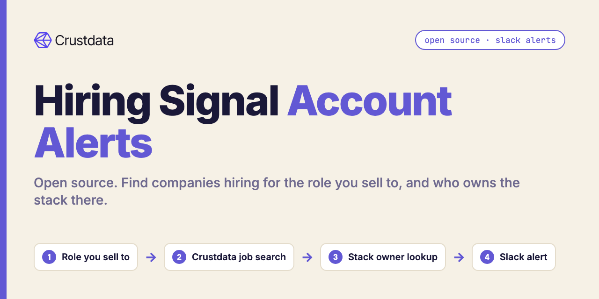
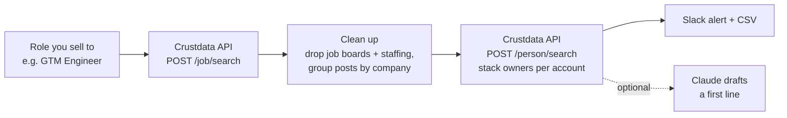

# Hiring Signal Account Alerts (Open Source, Slack Alerts)

**An open-source Python tool that finds companies that just posted a job for the role you sell to, and tells you who owns the stack there, in Slack.**

A new job post is a public buying signal: a company hiring its first GTM Engineer is about to buy GTM tools. This tool pulls those posts every week, removes job boards and staffing agencies, groups the posts by company, and adds the RevOps, GTM Ops or Growth people at each account. [Crustdata](https://crustdata.com) is the job and people data layer ([API docs](https://docs.crustdata.com)).



## How it works



1. **Find the posts.** `POST /job/search` with exact job titles (`job_details.title in [...]`), a posted-since date (`metadata.date_added`), country and company headcount range. Newest first, cursor pagination.
2. **Clean up.** Drop companies in staffing and recruiting industries and known reposting boards. Group the rest by Crustdata company ID, so three posts from one company become one account with `posts: 3`.
3. **Add the owner.** One `POST /person/search` per 25 accounts: people whose current employer is the account and whose current title matches your owner titles. Sellers of those services (for example agency account executives) are dropped.
4. **Alert.** Accounts you have not seen before (remembered in `.state/seen.json`) go to Slack and to `out/accounts.csv`.

## Quickstart

Requires Python 3.9+. No dependencies for the core tool.

```bash
git clone https://github.com/mhimed-crustdata/hiring-signal-alerts
cd hiring-signal-alerts
make setup        # creates .env, then add your CRUSTDATA_API_KEY
make demo         # runs the search and prints the summary, never posts to Slack
make run          # posts new accounts to SLACK_WEBHOOK_URL
make test         # unit tests, no network
```

Run it weekly with cron (`0 8 * * 1 cd /path/to/repo && make run`) or a scheduled CI job with your keys stored as secrets.

## Configuration

All settings live in `.env` (copy from `.env.example`). Command-line flags override them.

| Variable | Default | What it does |
|---|---|---|
| `CRUSTDATA_API_KEY` | required | Your Crustdata API key. Read from the environment only |
| `ROLES` | `GTM Engineer,GTM Systems Engineer,GTM AI Engineer,Go-to-Market Engineer` | Exact job titles that signal a need for what you sell |
| `OWNER_TITLES` | `Revenue Operations,RevOps,GTM Operations,Sales Operations,Head of Growth` | Who owns the stack at the account |
| `SINCE_DAYS` | `30` | Posts added in the last N days |
| `COUNTRY` | `United States` | Job location country. Empty means worldwide |
| `HEADCOUNT` | `11-50,51-200,201-500` | Company size ranges. Empty means any size |
| `SLACK_WEBHOOK_URL` | empty | Slack incoming webhook. Empty means no Slack post |
| `ANTHROPIC_API_KEY` | empty | Optional. With `--openers`, Claude drafts one first line per account |
| `ANTHROPIC_MODEL` | `claude-opus-5-5` | Model for the optional Claude step |

Useful flags: `--no-owners` (skip the people lookup), `--dry-run`, `--all`, `--max-jobs N`, `--out DIR`.

Examples for other teams:

```bash
python3 signals.py --roles "Head of Data,Data Engineer" --owner-titles "VP Engineering,Head of Data"
python3 signals.py --roles "Compliance Officer,BSA Officer" --owner-titles "Chief Compliance Officer" --headcount ""
```

Output files in `out/` contain personal data and are git-ignored.

## Example output

A real run on 2026-10-18 against the live API with the defaults (four GTM Engineer titles, last 30 days, United States, 11-500 employees). Aggregated from `out/accounts.json`:

```json
{
 "job_posts": 30,
 "accounts": 21,
 "dropped_resellers": 1,
 "accounts_with_stack_owner": 13,
 "by_headcount": {"51-200": 10, "201-500": 6, "11-50": 5},
 "accounts_with_2_or_more_posts": 5,
 "stack_owner_seniority": {"VP / SVP": 5, "Director / Head": 7, "Manager": 6, "Other": 5}
}
```

Hiring companies are public job posters, so the account list itself is safe to share. People are not shown here. A slice of the account rows:

| Company | Size | GTM Engineer posts | Latest post | Stack owner found |
|---|---|---|---|---|
| Pogo | 11-50 | 3 | 2026-10-12 | no |
| UpGuard | 201-500 | 1 | 2026-10-07 | yes |
| OnPay | 51-200 | 1 | 2026-10-06 | yes |
| DNSFilter | 51-200 | 3 | 2026-09-28 | yes |
| Agiloft | 201-500 | 1 | 2026-09-18 | yes |

What the Slack alert looks like (people redacted):

```text
:mag: 21 companies posted GTM Engineer / GTM Systems Engineer roles since 2026-09-18
• Pogo (11-50 people) 3 post(s), latest 2026-10-12 job · owner: no stack owner found
• UpGuard (201-500 people) 1 post(s), latest 2026-10-07 job · owner: [Name] ([RevOps title]), …
…and 19 more in out/accounts.csv
```

## How to build a hiring signal agent

1. **Pick a role that means "about to buy".** The first GTM Engineer, the first data engineer, a new compliance lead. Use exact titles (`in` on `job_details.title`) so near matches do not sneak in.
2. **Filter at the source.** Date, country and company size are all job search filters, so you pay for fewer rows and get cleaner lists.
3. **Clean like an SDR would.** Remove staffing agencies and job boards that repost other companies' roles, then group posts by company. Three posts from one company is a stronger signal than one.
4. **Find the person, not just the company.** Search people by current company ID and owner title, then re-check the title in code so a seller of RevOps services is not mistaken for the RevOps owner.
5. **Only alert on what's new.** A seen-list keeps the weekly message short.
6. **Use the model for the words.** The optional Claude step writes one opener from the job post context. It never chooses the accounts.
7. **Push it where reps work.** Slack for the alert, CSV for the CRM import. To go real time, swap the weekly search for a Crustdata job watch (see the [docs](https://docs.crustdata.com)).

## FAQ

**How do I find companies hiring for a role I sell to?**
Search job postings for the exact title of the person who will use your product, filtered by date, country and company size. This tool does that with Crustdata's job search and groups the results by company.

**Why add the stack owner?**
The person being hired is not on the team yet. The current RevOps, GTM Ops or Growth lead is the one who will buy the tools the new hire needs.

**How does it avoid job boards and staffing agencies?**
It drops companies in staffing and recruiting industries plus a short list of known reposting boards. Add names to `RESELLER_NAMES` in `signals.py` for your market.

**Can I use it for roles other than GTM Engineer?**
Yes. Set `ROLES` and `OWNER_TITLES` in `.env` or pass `--roles` and `--owner-titles`.

**Does it contact anyone?**
No. It only posts to your own Slack webhook when `SLACK_WEBHOOK_URL` is set and `--dry-run` is off.

**Which Crustdata endpoints does it use?**
`POST /job/search` and `POST /person/search` on API version `2025-11-01`. See the [Crustdata API docs](https://docs.crustdata.com).

## Project layout

```text
signals.py          # the workflow: job search, cleanup, owners, output
crustdata_api.py    # tiny Crustdata client (stdlib only)
notify.py           # optional Slack + Claude
tests/              # unit tests, no network
```

## License

MIT. See [LICENSE](LICENSE). Data layer: [Crustdata](https://crustdata.com) ([docs](https://docs.crustdata.com)).
